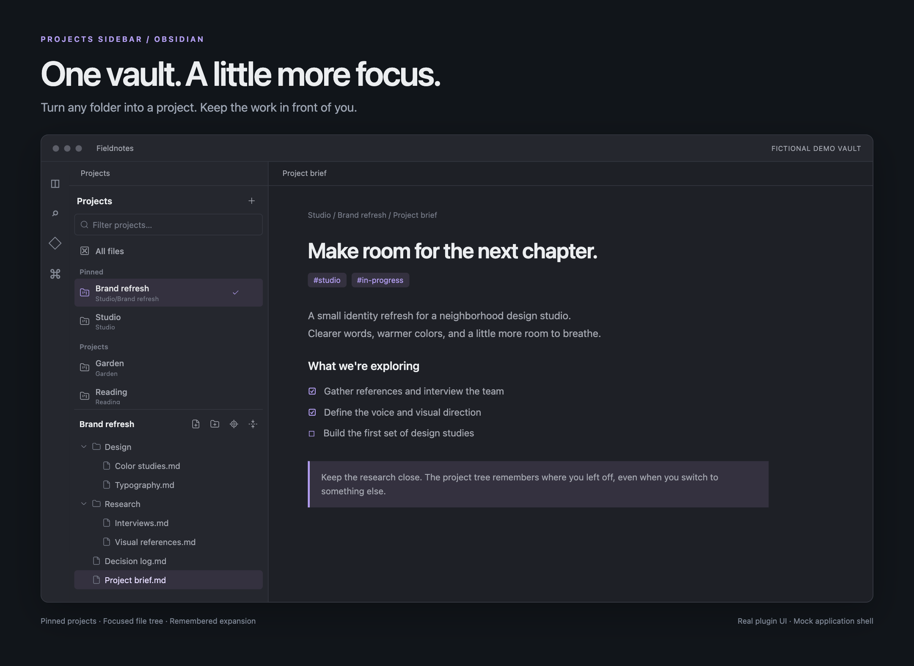
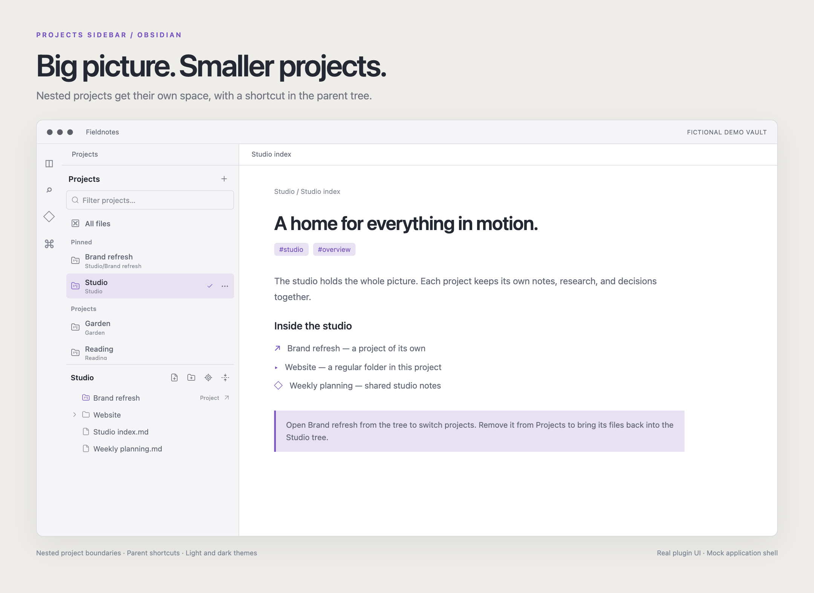

<div align="center">

# Projects Sidebar

**One vault. A little more focus.**

A lightweight project navigator for [Obsidian](https://obsidian.md).<br>
Choose a folder, pin your favorites, and settle into a file tree built around your work.

[](https://github.com/DIodide/obsidian-projects-sidebar/releases/latest)
[](https://github.com/DIodide/obsidian-projects-sidebar/actions/workflows/ci.yml)
[](LICENSE)
[](manifest.json)

[Install](#install) · [How it works](#how-it-works) · [Development](#development) · [Report a bug](https://github.com/DIodide/obsidian-projects-sidebar/issues)

</div>



<sub>Images render the actual plugin UI inside a mock application shell. All notes and folders belong to a fictional “Fieldnotes” vault.</sub>

## Your folders, with a sense of place

| | |
| :--- | :--- |
| **Focus on a project** | Make any vault folder a project. Its files stay right where they are. |
| **Find it quickly** | Filter by name or folder path; pin the projects you return to most. |
| **Go one level deeper** | Nested projects own their descendants and appear as shortcuts in their parent. |
| **Pick up where you left off** | Folder expansion is remembered independently for every project. |
| **Keep moving** | Navigate by keyboard, create notes and folders, or reveal the active file in its project. |
| **Keep the tree light** | Only visible tree rows and a small buffer are mounted. Editing a note does not rebuild the tree. |

## Install

Requires **Obsidian 1.8.0 or newer**. Install from GitHub; this plugin is not currently listed in Obsidian's community plugin directory.

### With BRAT

If you use [BRAT](https://github.com/TfTHacker/obsidian42-brat), choose **Add a beta plugin** and enter:

```text
https://github.com/DIodide/obsidian-projects-sidebar
```

### Manually

1. Download `projects-sidebar-1.0.0.zip` from the [latest release](https://github.com/DIodide/obsidian-projects-sidebar/releases/latest).
2. Extract the `projects-sidebar` folder into `<vault>/.obsidian/plugins/`.
3. Reload Obsidian and enable **Projects Sidebar** under **Settings → Community plugins**.

The resulting folder should contain `main.js`, `manifest.json`, and `styles.css` directly inside `.obsidian/plugins/projects-sidebar/`. Use the release ZIP, rather than GitHub's auto-generated source archive, for installation.

## How it works

1. Open **Projects** using the ribbon icon or **Projects Sidebar: Open Projects** in the command palette. It also opens automatically on startup by default.
2. Click **+** to choose a folder, or right-click a folder and select **Open as project**.
3. Select a project to focus its tree. Use **…** to pin it, change its display label, or remove it from the list.

**All files** brings back the full vault tree. Removing a project only removes its configuration; your files stay untouched.

### Nested projects feel natural

A project includes every descendant until another project begins. Register `Studio` and `Studio/Brand refresh`, and the parent tree shows a **Brand refresh · Project ↗** shortcut. Open it to switch to that project's tree.



Remove the nested project from the list and its subtree becomes part of the parent again. **Reveal active file in its project** chooses the deepest matching project and expands the folders leading to that file. Folder renames and moves update saved paths and expansion state.

### Keyboard and everyday actions

| Action | Shortcut or control |
| :--- | :--- |
| Move through the file tree | `↑` / `↓` |
| Expand or enter a folder | `→` |
| Collapse or move to its parent | `←` |
| Open a file or nested project | `Enter` / `Space` |
| Jump to the first or last row | `Home` / `End` |
| Open a file in a new tab | `Cmd` / `Ctrl` + click |
| Move from the filter to the project list | `↓` |
| Clear the project filter | `Esc` |
| Create a note or folder | Tree toolbar, or right-click a folder |
| Reveal the active file / collapse folders | Tree toolbar |

The command palette also offers **Switch project**, **Add folder as project**, **Show all vault files**, and **Reveal active file in its project**. Automatic opening can be turned off in the plugin's settings.

## Small by design

- Uses Obsidian's existing in-memory file objects; it never reads note contents.
- Traverses expanded folders only and stops at nested project boundaries.
- Windows the file-tree DOM to the viewport plus a small buffer. The automated suite checks that a 10,000-file tree mounts fewer than 40 rows with a simulated 400px viewport.
- Debounces create, delete, and rename events. No polling or refreshes on note edits and metadata changes.
- No network requests, telemetry, or bundled runtime dependencies. Settings stay in `.obsidian/plugins/projects-sidebar/data.json`.

> **Scope:** This plugin focuses navigation. It does not change global search, backlinks, or Obsidian's indexing, and it does not replace the original Files tab. The performance check above tests DOM windowing, not overall vault speed.

## Development

Use **Node.js 22+** and keep the checkout outside your vault.

```sh
npm ci
npm test
npm run build
```

`npm run package` creates the installable ZIP. `npm run screenshots` regenerates the images from fictional data using the actual sidebar source and CSS.

Tests cover project ownership, path boundaries, persisted state, renames, filtering, keyboard navigation, file opening, expansion restoration, empty folders, and large-tree windowing. Integration tests use jsdom and a small Obsidian API mock. The documentation renderer also checks switching and filtering in Chromium. **Live Obsidian and mobile testing remain unverified for this initial release.**

See [Contributing](CONTRIBUTING.md) for setup and release instructions, and the [Changelog](CHANGELOG.md) for version history.

## Credits & license

Inspired by [T3 Code](https://github.com/pingdotgg/t3code)'s project navigation. This is an independent implementation using Obsidian's native theme tokens and Lucide icons; it does not bundle T3 Code or connect to it. [Source references →](docs/ACKNOWLEDGMENTS.md)

[MIT](LICENSE) © Ibraheem Amin
